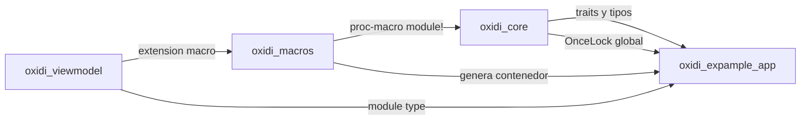

# Requirements

### Overview & Goals
Crear `oxidi`, un contenedor de inyección de dependencias (DI) para Rust que funcione como Koin en Kotlin Multiplatform, pero con **resolución 100% en compile time** y máxima eficiencia en runtime. Usa una macro `module!()` con DSL interno similar a Koin (`single`, `factory`, `viewModel`, etc.), con extensión vía macro plugin system para añadir nuevos service types. Las dependencias se resuelven con `get()` estilo Koin y también con parámetros tipados (hybrid approach). El contenedor se almacena en un `static OnceLock` global, permitiendo acceder a los servicios desde cualquier lugar con `oxidi::get::<T>()` sin tener que pasar el contenedor a las funciones.

### Scope

**In Scope:**
- Macro `module!()` con DSL interno estilo Koin
- Blocks `single {}`, `factory {}`, `singletons {}` dentro del DSL
- Resolución de dependencias con `get::<T>()` y parámetros tipados (hybrid)
- Contenedor global en `static OnceLock` con inicialización explícita vía `oxidi::init()`
- `oxidi::get::<T>()` global para acceder a servicios desde cualquier lugar sin pasar el contenedor
- `inject()` function para extraer servicios del contenedor en código externo con inferencia de tipo
- Macro plugin system para extensión (ej. `viewModel!` module type)
- Detección de ciclos y dependencias faltantes en compile time
- Contenedor ligero sin HashMap ni reflexión en runtime
- Soporte para singletons y factories
- Inyección de valores primitivos (String, int, etc.)
- App de ejemplo que demuestra el uso

**Out of Scope:**
- Scopes jerárquicos (como Koin scopes)
- Qualifiers personalizados
- Lazy loading con cancelación
- Integración con frameworks específicos (Tauri, egui, etc.)

### User Stories
- As a developer, quiero definir mis servicios con un DSL similar a Koin para que el código sea familiar y legible
- As a developer, quiero resolver dependencias con `get()` como en Koin para mantener consistencia con mi experiencia en Kotlin
- As a developer, quiero acceder a servicios desde cualquier lugar con `oxidi::get::<T>()` sin pasar el contenedor a las funciones
- As a developer, quiero inicializar el contenedor explícitamente en `main()` con `oxidi::init()` para controlar cuándo se crean los servicios
- As a developer, quiero extraer servicios del contenedor en código externo usando `inject()` con inferencia de tipo para no escribir `::<T>()` manualmente
- As a developer, quiero que los errores de dependencias faltantes aparezcan en compile time para no tener crashes en runtime
- As a developer, quiero extender el crate con nuevos tipos de módulos (como viewModel) sin modificar el core

### Functional Requirements
1. `module!()` macro con DSL interno para definir módulos de servicios
2. `single {}` block para servicios de una sola instancia
3. `factory {}` block para servicios que crean nueva instancia cada vez
4. `get::<T>()` para resolver dependencias dentro de los blocks
5. Parámetros tipados como alternativa a `get()` (hybrid approach)
6. `oxidi::init(module!)` para inicializar el contenedor global en `main()`
7. `oxidi::get::<T>()` global para acceder a servicios desde cualquier lugar
8. `inject(container)` function para extraer servicios del contenedor en código externo con inferencia de tipo
9. Macro plugin system para añadir nuevos service types (ej. `viewModel`)
10. Errores de compilación descriptivos cuando falta una dependencia o hay un ciclo

### Non-Functional Requirements
- Cero allocations en el path crítico de resolución
- Sin uso de `HashMap`, `Box<dyn Any>`, o reflexión
- Generar código que el optimizer de LLVM pueda inline completamente
- Errores de compilación claros y accionables
- DSL legible y similar a Koin para developers que vienen de Kotlin

# Technical Design

### Current Implementation
El workspace tiene tres crates vacías:
- `oxidi_core` — solo contiene `add()` placeholder
- `oxidi_macros` — solo contiene `add()` placeholder (no configurado como proc-macro crate)
- `oxidi_expample_app` — `println!("Hello, world!")`

### Key Decisions

**1. Macro `module!()` con DSL interno (no atributos)**
En lugar de usar `#[module]` como atributo sobre un mod, se usa una macro declarativa `module!()` que contiene un DSL con blocks `single {}`, `factory {}`, etc. Esto permite un DSL más flexible y similar a Koin, con mejor control sobre la sintaxis.

**2. Hybrid dependency resolution (`get()` + typed params)**
Dentro de cada block, las dependencias se pueden resolver con `get::<T>()` (estilo Koin) o con parámetros tipados en la función. El macro soporta ambos enfoques para máxima flexibilidad.

**3. Contenedor global con `OnceLock` e inicialización explícita**
El contenedor generado se almacena en un `static OnceLock<Container>` global en `oxidi_core`. La función `oxidi::init()` acepta el resultado de `module!()` y lo almacena en el `OnceLock`. Esto permite controlar cuándo se inicializa el contenedor (en `main()`), pero una vez inicializado, los servicios son accesibles desde cualquier lugar con `oxidi::get::<T>()` sin pasar el contenedor manualmente. Se elige `OnceLock` sobre `LazyLock` porque da control explícito sobre la inicialización, permitiendo pasar datos de runtime como configuración o argumentos.

**4. Función `get()` global con inferencia de tipo**
La función `oxidi::get::<T>()` accede al contenedor global y devuelve el servicio de tipo `T`. Cuando se usa con asignación (`let db: Database = get()`), el tipo se infiere automáticamente. Internamente, usa un trait `Resolvable<T>` que se implementa para cada tipo registrado en el contenedor.

**5. Inject function con inferencia de tipo**
Fuera del `module!()`, la función `inject(container)` usa un trait `Injectable<T>` para inferir automáticamente el tipo del servicio desde el contexto. El usuario no necesita escribir `::<T>()` manualmente. El trait se implementa para cada tipo registrado en el contenedor.

**6. Macro plugin system para extensión**
El `module!` macro acepta sub-macros extensibles vía conventions. Un crate extension puede definir su propia macro (ej. `viewModel!`) que genera código compatible con el contenedor principal. Esto permite añadir nuevos service types sin modificar oxidi_core.

**7. Contenedor como struct tipado (no runtime registry)**
Cada servicio registrado se convierte en un campo del struct contenedor. La resolución es un simple acceso a campo (`.service_name`), que el compiler puede inline completamente. Sin HashMap ni reflexión.

### Architecture



**Flujo de compilación:**
1. El usuario escribe `module!(...)` con blocks `single`, `factory`, etc.
2. `oxidi_macros` parsea el DSL y extrae servicios y dependencias
3. El macro analiza el graf de dependencias (ciclos, faltantes)
4. Genera un struct contenedor con campos tipados
5. Genera `impl New` que construye servicios en orden topológico
6. En runtime, `oxidi::init(module!)` construye el contenedor y lo almacena en el `OnceLock` global
7. Los servicios se acceden con `oxidi::get::<T>()` desde cualquier lugar

### Proposed Changes

#### `oxidi_macros` — Proc-macro crate
- Configurar como `proc-macro = true`
- Dependencias: `proc-macro2`, `quote`, `syn`
- `module!()` — macro declarativa con DSL interno
- Parser del DSL: `single {}`, `factory {}`, `singletons {}`, `get::<T>()`
- Analyzer: graf de dependencias, detección de ciclos, topological sort
- Codegen: genera struct contenedor, impl New, accessors
- Plugin system: conventions para macros de extensión (ej. `viewModel!`)

#### `oxidi_core` — Runtime library
- Traits base: `OxidiModule` (marker para módulos generados)
- Traits para resolución global: `Resolvable<T>` para `oxidi::get::<T>()`
- Traits para inyección: `Injectable<T>` para inferencia de tipo en `inject()`
- Tipos helper: `Factory<T>`, `Get` (para `get()` dentro del DSL)
- `static OnceLock<Container>` global para almacenar el contenedor
- `oxidi::init()` para inicializar el contenedor global desde `main()`
- `oxidi::get::<T>()` global para acceder a servicios sin pasar el contenedor
- `inject()` function que usa el trait `Injectable<T>` para inferir tipos
- Zero-cost runtime: solo traits y tipos, sin contenedor dinámico
- Convention traits para extensiones: `OxidiModulePlugin`

#### `oxidi_expample_app` — Demo
- Ejemplo con servicios reales: `Database`, `Repository`, `Service`, `App`
- Demostrar `module!()` con DSL estilo Koin
- Demostrar `get()` y parámetros tipados (hybrid)
- Demostrar errores de compile time (dependencia faltante, ciclo)

### Data Models / Contracts

**API esperada (usage):**
```rust
use oxidi_macros::module;
use oxidi_core::{get, inject};

fn main() {
    // Inicializar el contenedor global desde main()
    oxidi::init(module! {
        single {
            Database::new("postgres://localhost")
        }

        single {
            let db: Database = get();
            UserRepository::new(db)
        }

        factory {
            let repo: UserRepository = get();
            RequestHandler::new(repo)
        }

        // Hybrid: parámetros tipados
        single {
            UserRepository::new(get::<Database>())
        }
    });

    // Ahora los servicios son accesibles desde cualquier lugar
    let db: Database = get(); // tipo inferido desde la asignación
    let handler = get::<RequestHandler>(); // factory, nueva instancia
}

// Uso FUERA del módulo - sin pasar el contenedor:
fn my_function() {
    let db: Database = get(); // acceso global, sin contenedor
    let repo: UserRepository = get(); // sin ::<T>() necesario si hay inferencia
}

// También se puede usar inject() con un contenedor local si se necesita:
fn my_function_with_container(container: &OxidiContainer) {
    let db: Database = inject(container); // tipo inferido desde la asignación
    let repo: UserRepository = inject(container); // sin ::<T>() necesario
}

// También se puede usar en struct con #[inject] attribute:
struct MyService {
    #[inject]
    db: Database,
    #[inject]
    repo: UserRepository,
}

// O en funciones:
fn process_data(inject::<Database>(container)) {
    // ...
}
```

**Get global API (acceso sin contenedor):**
```rust
// En oxidi_core
use std::sync::OnceLock;

static CONTAINER: OnceLock<OxidiContainer> = OnceLock::new();

pub fn init(container: OxidiContainer) {
    CONTAINER.set(container).expect("Contenedor ya inicializado");
}

pub fn get<T>() -> T
where
    OxidiContainer: Resolvable<T>,
    T: Clone,
{
    let container = CONTAINER.get().expect("Contenedor no inicializado. Llama a oxidi::init() primero.");
    OxidiContainer::resolve(container)
}

// Trait Resolvable<T> para acceso global:
pub trait Resolvable<T> {
    fn resolve(container: &OxidiContainer) -> T;
}

// Implementación generada por module! para cada tipo:
impl Resolvable<Database> for OxidiContainer {
    fn resolve(container: &OxidiContainer) -> Database {
        container.database.clone()
    }
}

impl Resolvable<RequestHandler> for OxidiContainer {
    fn resolve(container: &OxidiContainer) -> RequestHandler {
        container.request_handler() // factory, nueva instancia
    }
}
```

**Inject API (inferencia de tipo con contenedor local):**
```rust
// En oxidi_core
pub trait Injectable<T> {
    fn inject_from(container: &OxidiContainer) -> T;
}

// Implementación generada por module! para cada tipo:
impl Injectable<Database> for OxidiContainer {
    fn inject_from(container: &OxidiContainer) -> Database {
        container.database.clone()
    }
}

// La función inject usa el trait:
pub fn inject<T>(container: &OxidiContainer) -> T
where
    OxidiContainer: Injectable<T>,
    T: Clone,
{
    OxidiContainer::inject_from(container)
}

// Uso con inferencia:
let db: Database = inject(&container); // T inferido desde el tipo de 'db'
```

**Código generado (interno):**
```rust
// Generado por module!
pub struct OxidiContainer {
    database: Database,
    user_repo: UserRepository,
    request_handler_factory: fn(&UserRepository) -> RequestHandler,
}

impl OxidiContainer {
    pub fn new() -> Self {
        let database = Database::new("postgres://localhost");
        let user_repo = UserRepository::new(database.clone());
        Self {
            database,
            user_repo,
            request_handler_factory: |repo| RequestHandler::new(repo.clone()),
        }
    }

    pub fn request_handler(&self) -> RequestHandler {
        (self.request_handler_factory)(&self.user_repo)
    }
}

// Generado para get() global - Resolvable trait implementations:
impl oxidi_core::Resolvable<Database> for OxidiContainer {
    fn resolve(container: &OxidiContainer) -> Database {
        container.database.clone()
    }
}

impl oxidi_core::Resolvable<UserRepository> for OxidiContainer {
    fn resolve(container: &OxidiContainer) -> UserRepository {
        container.user_repo.clone()
    }
}

impl oxidi_core::Resolvable<RequestHandler> for OxidiContainer {
    fn resolve(container: &OxidiContainer) -> RequestHandler {
        container.request_handler()
    }
}

// Generado para inject() - Injectable trait implementations:
impl oxidi_core::Injectable<Database> for OxidiContainer {
    fn inject_from(container: &OxidiContainer) -> Database {
        container.database.clone()
    }
}

impl oxidi_core::Injectable<UserRepository> for OxidiContainer {
    fn inject_from(container: &OxidiContainer) -> UserRepository {
        container.user_repo.clone()
    }
}

impl oxidi_core::Injectable<RequestHandler> for OxidiContainer {
    fn inject_from(container: &OxidiContainer) -> RequestHandler {
        container.request_handler()
    }
}
```

### File Structure
```
oxidi_macros/
├── Cargo.toml              # proc-macro = true, deps: syn, quote, proc-macro2
└── src/
    ├── lib.rs              # entry point: module! macro
    ├── dsl_parser.rs       # parsing del DSL interno (single, factory, get)
    ├── analyzer.rs         # análisis de graf de dependencias, detección de ciclos
    ├── codegen.rs          # generación de código del contenedor
    └── plugin.rs           # convention traits para extensiones

oxidi_core/
├── Cargo.toml              # dep: oxidi_macros (dev-dependency para ejemplos)
└── src/
    ├── lib.rs              # traits: OxidiModule, OxidiModulePlugin, Factory<T>
    └── types.rs            # Factory<T> wrapper, Get helper, helpers

oxidi_expample_app/
├── Cargo.toml              # deps: oxidi_core, oxidi_macros
└── src/
    └── main.rs             # demo con servicios reales y DSL estilo Koin
```

### Risks
- **Ciclos de dependencia**: Detectar en compile time requiere un análisis de graf completo en el proc-macro. Si dos módulos se referencian mutuamente, el análisis debe ser cross-module.
- **Clonación de singletons**: Para que los singletons sean compartibles entre servicios, necesitarán `Clone` o `Arc`. Esto se debe documentar claramente.
- **DSL parsing complexity**: El DSL interno necesita un parser robusto para manejar `get()`, blocks anidados, y extensiones. Syn puede ayudar pero requiere cuidado.
- **Error reporting**: Los errores de proc-macro deben ser claros. Un ciclo `A -> B -> C -> A` debe reportarse con el camino completo.
- **Plugin system conventions**: Las extensiones deben seguir conventions claras para que el codegen las reconozca. Documentación necesaria.
- **OnceLock no inicializado**: Si el código llama a `oxidi::get()` antes de `oxidi::init()`, se produce un panic. Esto se debe documentar claramente y considerar un mensaje de error descriptivo.
- **Tests con contenedor global**: Los tests pueden interferir entre sí si comparten el contenedor global. Se necesita un mecanismo para resetear el contenedor entre tests o usar contenedores locales para tests.

# Testing

### Validation Approach
Verificar que el sistema funcione correctamente compilando y ejecutando la app de ejemplo, y que los errores de compile time se generen correctamente.

### Key Scenarios
1. **Singleton básico**: Un servicio sin dependencias se resuelve correctamente con `single {}`
2. **Dependencia entre singletons**: `ServiceA` depende de `ServiceB` vía `get()`, ambos se inicializan en orden
3. **Factory**: Cada llamada produce una instancia nueva con `factory {}`
4. **Múltiples dependencias**: Un servicio depende de 3+ otros servicios vía `get()`
5. **Hybrid resolution**: Mix de `get()` y parámetros tipados en el mismo módulo
6. **Clonación**: Singletons compartidos entre múltiples consumidores
7. **Get global**: `oxidi::get::<T>()` accede al servicio desde cualquier lugar sin pasar el contenedor
8. **Init explícito**: `oxidi::init()` inicializa el contenedor global desde `main()`
9. **Inject con inferencia**: `inject(&container)` infiere correctamente el tipo desde el contexto
10. **Inject en código externo**: Servicios se pueden extraer del contenedor en funciones fuera del módulo

### Edge Cases
1. **Ciclo de dependencia**: `A -> B -> A` debe fallar en compile time con mensaje claro
2. **Dependencia faltante**: Servicio que referencia un tipo no registrado en el módulo
3. **Servicio no usado**: Compila sin warnings (los singletons se construyen en `new()`)
4. **Factory con dependencias mutables**: Verificar que el closure capture correctamente
5. **Extension block**: Verificar que un bloque `view_model` se procesa correctamente
6. **Inject sin inferencia clara**: Error de compilación claro cuando el tipo no se puede inferir
7. **Inject de factory**: Verificar que `inject()` llama al factory y no devuelve el singleton
8. **Get antes de init**: Llamar a `oxidi::get()` antes de `oxidi::init()` debe producir un panic con mensaje claro
9. **Init múltiple**: Llamar a `oxidi::init()` dos veces debe producir un error claro
10. **Tests concurrentes**: Verificar que los tests no interfieran entre sí con el contenedor global

### Test Changes
- Tests unitarios en `oxidi_macros` para el DSL parser y analyzer
- Tests de compilación en `oxidi_expample_app` que verifiquen el código generado
- Test de ciclo de dependencia (compile-fail test usando `trybuild`)

# Alternatives Considered

### Alternative 1: Build-script only (sin proc-macros)
En lugar de proc-macros, un `build.rs` escanea el código fuente y genera el contenedor.
- **Con**: Más control sobre el análisis, acceso a todo el código del proyecto
- **Contra**: No tiene acceso a la AST, parsing manual de Rust es frágil, no se integra con IDE
- **Rechazado**: Los proc-macros son más robustos y tienen mejor tooling

### Alternative 2: Runtime registry con type-id (como dependencia_inject)
Usar `TypeId` para registrar y resolver servicios en runtime.
- **Con**: Más flexible, permite registro dinámico
- **Contra**: Violación del requisito de 100% compile time, overhead de HashMap, errores en runtime
- **Rechazado**: El usuario pidió explícitamente compile time

### Alternative 3: Solo declarative macros (sin proc-macros)
Usar macros by example (`macro_rules!`) para generar el contenedor.
- **Con**: Sin dependencias externas
- **Contra**: API muy verbosa, sin análisis de dependencias, sin detección de ciclos
- **Rechazado**: No permite el análisis ni la API limpia que Koin ofrece

# Delivery Steps

### ✓ Step 1: Configurar oxidi_macros como proc-macro crate
Transformar oxidi_macros de una lib crate a un proc-macro crate funcional con estructura de archivos.
- Actualizar `Cargo.toml` con `proc-macro = true` y dependencias (`syn`, `quote`, `proc-macro2`)
- Crear la estructura de archivos: `dsl_parser.rs`, `analyzer.rs`, `codegen.rs`, `plugin.rs`
- Implementar `module!()` macro entry point que parsea el DSL interno
- Implementar parsing de blocks `single {}`, `factory {}`, y `get::<T>()`

### ✓ Step 2: Implementar analyzer de dependencias
Construir el motor de análisis del graf de dependencias dentro del proc-macro.
- En `analyzer.rs`: construir un graf dirigido a partir de las llamadas a `get()` en cada block
- Implementar detección de ciclos (DFS con back-edge detection)
- Implementar detección de dependencias faltantes (tipo usado pero no definido en el módulo)
- Generar `compile_error!` con mensajes descriptivos que incluyan el camino del ciclo o la dependencia faltante
- Topological sort para determinar el orden de inicialización

### ✓ Step 3: Implementar codegen del contenedor
Generar código Rust que construye el contenedor con campos tipados.
- En `codegen.rs`: generar un `struct` contenedor con un campo por singleton
- Para factories: generar un campo `fn() -> T` que capture las dependencias
- Generar `impl New` que construye servicios en orden topológico
- Generar accessors: campos `pub` para singletons, métodos para factories
- Asegurar que servicios compartidos entre dependencias usen `Clone` o `Arc`
- El código generado debe ser limpio y legible (usable con `cargo expand`)

### ✓ Step 4: Implementar oxidi_core runtime, get() global, y plugin system
Crear la library base con traits, tipos helper, contenedor global, y convention para extensiones.
- Definir `OxidiModule` trait (marker para módulos generados)
- Definir `Factory<T>` struct que envuelve closures de creación
- Definir `OxidiModulePlugin` trait para extensiones (ej. viewModel)
- Definir `static OnceLock<OxidiContainer>` global para almacenar el contenedor
- Implementar `oxidi::init()` para inicializar el contenedor global desde `main()`
- Implementar `oxidi::get::<T>()` global con trait `Resolvable<T>` para acceso sin contenedor
- Definir helpers para valores primitivos inyectables
- Documentar los requisitos: servicios deben ser `Clone` o envueltos en `Arc` para compartirse
- Documentar el orden de inicialización: `init()` debe llamarse antes de cualquier `get()`

### ✓ Step 5: Crear app de ejemplo y validar
Construir oxidi_expample_app como demo funcional y validar todo el sistema.
- Definir servicios de ejemplo: `Database`, `UserRepository`, `RequestHandler`, `Logger`
- Crear un módulo con `module!()` que registre singletons y factories usando DSL estilo Koin
- Demostrar `oxidi::init()` en `main()` para inicializar el contenedor global
- Demostrar `oxidi::get::<T>()` desde funciones sin contenedor
- Demostrar `get()` y parámetros tipados (hybrid approach) dentro del DSL
- Demostrar inyección: `Database` → `UserRepository` → `RequestHandler`
- Verificar que compila y ejecuta correctamente
- Verificar que un ciclo de dependencia produce error de compilación claro
- Verificar que `get()` antes de `init()` produce panic con mensaje claro
- Actualizar `Cargo.toml` con las dependencias correctas